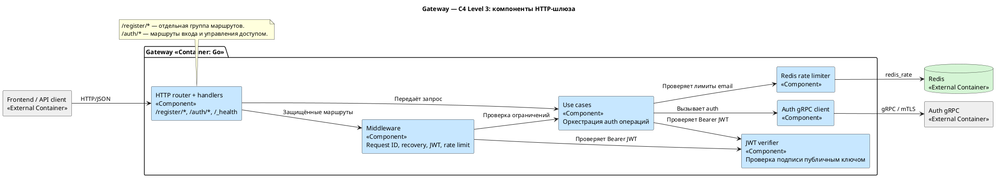
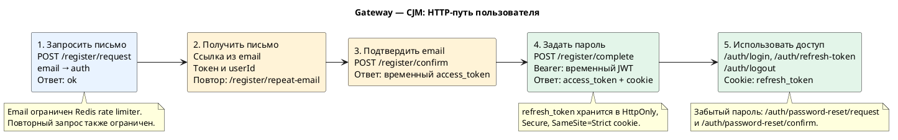
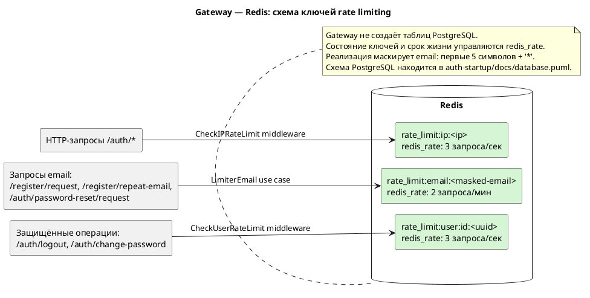

# Gateway project service

Gateway — публичный HTTP/JSON вход в сервисы аутентификации [Auth project (KLoad)](https://github.com/Weit145/auth-project). Он принимает запросы frontend и API-клиентов, проверяет Bearer JWT, применяет rate limiting и вызывает [Auth](https://github.com/Weit145/auth-startup/tree/confirm-email#readme) по gRPC с mTLS. Аккаунты и сессии хранятся в Auth; Gateway управляет HTTP-контрактом и refresh cookie.

## Архитектура — C4 Level 3

[Открыть SVG](docs/diagrams/c4-component.svg) · [Исходник PlantUML](docs/diagrams/c4-component.puml)

| Компонент | Роль |
| --- | --- |
| HTTP router и handlers | Маршруты `/register/*`, `/auth/*`, `/_health` и Swagger; проверка и формирование JSON. |
| Middleware | Request ID, логирование, восстановление после panic, проверка Bearer JWT и ограничение частоты запросов. |
| Use cases | Передают операции Auth по gRPC и обращаются к Redis limiter. |
| JWT verifier | Проверяет подпись RS256 публичным ключом Auth, срок действия, issuer и audience. |
| Redis repository | Хранит временное состояние rate limiting. |
| Auth gRPC client | Вызывает внутренний сервис Auth по mTLS. |

Регистрация в действующем API находится на `/register/*`. `/auth/*` содержит вход и операции с уже созданной учётной записью. Это отражает [текущий router](internal/transport/api/v1/router.go).

## Путь пользователя

[Открыть SVG](docs/diagrams/cjm.svg) · [Исходник PlantUML](docs/diagrams/cjm.puml)

## Основные HTTP-маршруты

| Метод и путь | Что делает |
| --- | --- |
| `POST /register/request` | Принимает email и запрашивает письмо подтверждения. |
| `POST /register/repeat-email` | Повторно запрашивает письмо для ожидающей регистрации. |
| `POST /register/confirm` | Принимает `token` и `userId` из письма; возвращает временный JWT в поле `access_token`. |
| `POST /register/complete` | Принимает пароль и временный JWT в Bearer-заголовке; возвращает обычный access token и устанавливает refresh cookie. |
| `POST /auth/login` | Вход по email и паролю. |
| `POST /auth/refresh-token`, `POST /auth/logout` | Обновление или отзыв refresh-сессии. |
| `POST /auth/change-password` | Смена пароля при наличии access JWT. |
| `POST /auth/password-reset/request`, `POST /auth/password-reset/confirm` | Восстановление забытого пароля. |
| `GET /_health` | Проверка состояния Auth. |

После регистрации и входа refresh token передаётся в cookie `refresh_token` с флагами `HttpOnly`, `Secure` и `SameSite=Strict`; access token возвращается в JSON. Подробный HTTP-контракт доступен в [Swagger](docs/api/swagger.yaml). Пользовательский путь показан на [CJM](docs/diagrams/cjm.png).

## Схема данных — Redis

[Открыть SVG](docs/diagrams/database.svg) · [Исходник PlantUML](docs/diagrams/database.puml)

Gateway не создаёт таблиц PostgreSQL. Его Redis-ключи — временное состояние библиотеки `redis_rate`:

| Префикс ключа | Где используется | Лимит |
| --- | --- | --- |
| `rate_limit:ip:<ip>` | Middleware на маршрутах `/auth/*` | 3 запроса в секунду |
| `rate_limit:user:id:<uuid>` | Защищённые `/auth/logout` и `/auth/change-password` | 3 запроса в секунду |
| `rate_limit:email:<masked-email>` | Запросы письма регистрации, повторного письма и сброса пароля | 2 запроса в минуту |

Для email-ключа текущая реализация оставляет первые пять символов адреса, остальные заменяет `*`. У маршрутов `/register/*` нет общего IP middleware из группы `/auth/*`; лимит email применяется только к `request` и `repeat-email`. Структура постоянных учётных данных описана в [схеме PostgreSQL Auth](https://github.com/Weit145/auth-startup/blob/confirm-email/docs/diagrams/database.png).

## Запуск

Go-модуль сервиса: `github.com/Weit145/gateway-project-service`. Общий gRPC-контракт —
[`github.com/weit145/proto-startup`](https://github.com/Weit145/proto-startup), версия `v1.0.0`.
Зависимости Go и их версии перечислены в [go.mod](go.mod).

В составе стека выполните `make build` из [корня проекта](https://github.com/Weit145/auth-project#readme). Основные настройки Gateway: `HTTP_ADDRESS`, `AUTH_GRPC_ADDR`, `REDIS_ADDR`, `JWT_PUBLIC_KEY_PATH` и пути клиентского сертификата `AUTH_GRPC_TLS_*`. После запуска API доступно на `http://localhost:8080`, а Swagger через frontend — на `http://localhost:3000/swagger/index.html`. Клиентский браузер обычно обращается к Gateway через nginx-прокси frontend по `/api/*`.
